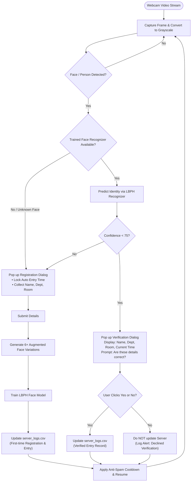

# Hostel Security Monitoring & Biometric Check-In System (PS2)
**Comprehensive Project Report & Presentation Deck**

---

## Part 1: Comprehensive Project Report

### 1. Executive Summary
In educational institutions and residential hostels, monitoring visitor and resident movement through manual registers is error-prone, slow, and insecure. This project presents a computer-vision-driven **Hostel Security Monitoring and Automated Verification System**. 

The system leverages real-time webcam video feeds to detect individuals, register first-time entrants with an automated entry timestamp, and recognize returning residents. Crucially, it incorporates a **Human-in-the-Loop (HITL) verification mechanism**: when a recognized student visits the camera, their details (Name, Department, Room Number, and current timestamp) are presented on-screen for confirmation. The server log is updated **only upon explicit user approval**, preventing erroneous check-ins while maintaining a tamper-evident audit trail.

---

### 2. Problem Statement (PS2)
**Original Objective:**
> Detect intruders/persons from CCTV/webcam footage with minimal complexity.

**Evolution into an Intelligent Check-In System:**
While basic motion/person detection alerts hostel security that someone is present, it lacks identity attribution and access records. The enhanced system bridges security surveillance with automated hostel administration by:
1. Identifying whether a detected individual is a known resident or an unregistered visitor.
2. Automating the intake process with zero manual timestamp tampering (the system records entry time automatically).
3. Ensuring biometric re-identification on repeat visits with two-factor visual confirmation before committing entries to the server database.

---

### 3. System Architecture & Workflow



---

### 4. Technical Stack & Implementation Details

| Layer | Technology | Role |
| :--- | :--- | :--- |
| **Language** | Python 3.12 | Core programming and runtime environment |
| **Computer Vision** | OpenCV (`cv2`) 4.14 | Video capture, frame preprocessing, Haar Cascades, and image manipulation |
| **Biometric AI** | LBPH Face Recognizer (`cv2.face`) | Local Binary Patterns Histograms for lighting-resilient facial recognition |
| **User Interface** | Python `tkinter` | Lightweight, native modal popup windows for registration and verification |
| **Database / Server** | `server_logs.csv` & `students.json` | Persistent record-keeping and student identity mapping |
| **Environment Tooling**| `uv` + Virtual Environment (`.venv`) | Fast, reproducible package management |

#### Key Technical Modules:
1. **Face Detection via Haar Cascades**: Rapidly localizes facial bounding boxes with low CPU overhead.
2. **One-Shot Face Augmentation**: Generates flipped, rotated ($\pm 8^\circ$), and gamma-adjusted brightness variations from a single capture to allow robust local training.
3. **Local Binary Patterns Histograms (LBPH)**: Unlike heavy deep neural networks, LBPH computes texture descriptors locally. It runs at 30+ FPS on standard CPU hardware without GPU acceleration.
4. **Tamper-Proof Auto Timestamps**: The entry timestamp is derived directly from the system clock at the instant of detection and rendered in a read-only field.
5. **Human-in-the-Loop (HITL) Validation**: Mitigates biometric false-positive rates by requiring confirmation before persisting data to the server log.

---

### 5. Server Database Schema

#### `server_logs.csv`
Tracks all verified check-ins and registrations:
```csv
Timestamp,Student_ID,Name,Department,Room_No,Status
2026-10-04 11:15:30,1,Lakshana S,CSE,A-204,First-Time Registration & Entry
2026-10-04 11:22:15,1,Lakshana S,CSE,A-204,Verified Entry (Server Updated)
```

#### `students.json`
Maintains registered student identity metadata:
```json
{
  "1": {
    "name": "Lakshana S",
    "dept": "CSE",
    "room": "A-204",
    "registered_at": "2026-10-04 11:15:30"
  }
}
```

---

### 6. What I Have Done (Step-by-Step Milestones)

1. **Phase 1 — Minimal Viable Intruder Detector**:
   - Engineered a 29-line baseline using OpenCV's built-in HOG (Histogram of Oriented Gradients) person detector.
   - Connected live video capture from the primary webcam (`cv2.VideoCapture(0)`).
   - Rendered bounding boxes and console alerts with timestamps.

2. **Phase 2 — Isolated Environment Setup**:
   - Initialized a sandboxed Python 3.12 virtual environment using modern tooling (`uv`).
   - Resolved dependency compatibility (ensuring OpenCV 4.x stability for biometric modules).
   - Created automated launch scripts ([run.bat](file:///C:/Users/Lakshana%20S/.gemini/antigravity/scratch/hostel_security%202/run.bat)) for one-click execution.

3. **Phase 3 — Interactive Registration & Automated Timestamping**:
   - Designed a non-blocking GUI dialog using Tkinter that triggers when an unregistered person steps into view.
   - Auto-generated system timestamps to prevent manual manipulation.
   - Collected resident profile data: Full Name, Department, and Room Number.

4. **Phase 4 — On-The-Fly Biometric Training & Re-Identification**:
   - Built a dataset pipeline that saves structured face crops and augments them with geometric and photometric variations.
   - Integrated `cv2.face.LBPHFaceRecognizer` for real-time inference.

5. **Phase 5 — Verification & Server Gatekeeping**:
   - Implemented a dual-confirmation modal when returning students are recognized.
   - Enforced conditional server logging: the server updates **only** when verified by the user.

---

### 7. What I Have Learned

#### A. Computer Vision Concepts
- **Haar Cascades vs. HOG vs. Deep Learning**: Learned the trade-offs between computational cost, inference speed, and accuracy on commodity CPU hardware.
- **Biometric Pattern Recognition (LBPH)**: Understood how local binary patterns encode micro-textures of faces and why histogram equalization improves invariance to ambient room lighting.
- **Data Augmentation**: Learned how synthetic perturbations (rotation, horizontal mirroring, gamma adjustments) enhance training robustness from a single sample.

#### B. Software Engineering & Systems Design
- **Event-Driven UI Integration**: Successfully synchronized OpenCV's frame-by-frame loop with Tkinter's modal event loop without thread starvation or window freezing.
- **Audit Logging & Idempotency**: Designed clean CSV/JSON database schemas that prevent duplicate entries using debouncing and cooldown algorithms.
- **Human-in-the-Loop (HITL) Architecture**: Recognized the value of manual confirmation steps in AI workflows to eliminate false-positive logging.

---

<br>

---

## Part 2: PowerPoint (PPT) Presentation Deck

### Slide 1: Title Slide
- **Title**: Smart Hostel Security & Biometric Check-In System
- **Subtitle**: Computer-Vision-Based Resident Re-identification & Verification
- **Category**: Problem Statement 2 (PS2) — Security & Surveillance
- **Presenter**: Lakshana S
- **Date**: October 2026
> **Speaker Notes:**
> *"Good morning everyone. Today I am presenting our Smart Hostel Security and Biometric Check-In System. This project transforms passive CCTV monitoring into an active, intelligent check-in system that detects residents, automates entry logs, and safeguards data integrity through biometric verification."*

---

### Slide 2: The Problem & Real-World Context
- **The Challenge**:
  - Traditional hostel entry registers are manual, time-consuming, and prone to proxy signing.
  - Standard CCTV footage is passive; security guards cannot manually verify every individual entering the gate.
  - Inaccurate timekeeping leads to administrative disputes regarding curfew adherence.
- **The Need**:
  - An automated, vision-based gatekeeping system that detects persons, verifies identity, and creates tamper-proof check-in records.
> **Speaker Notes:**
> *"In almost every hostel, students write their name, department, and entry time in a physical book. This leads to long queues, inaccurate time entries, and easy impersonation. Our objective is to automate this process using computer vision and human-in-the-loop verification."*

---

### Slide 3: Proposed Solution Overview
- **Real-Time Video Surveillance**: Instant face localization using OpenCV.
- **Automated Registration**: First-time entrants are registered with system-locked timestamps.
- **Biometric Re-Identification**: Returning students are recognized via local face descriptors.
- **HITL Verification**: Server database records the check-in *only* when the recognized student confirms their details.
- **Zero Heavy Infrastructure**: Runs entirely on commodity laptop/desktop hardware without expensive GPUs.
> **Speaker Notes:**
> *"Our solution handles two key scenarios: when a new person arrives, they register in under 10 seconds. When they return, the camera recognizes them and asks for confirmation. Only upon clicking 'Yes' does the server commit the record."*

---

### Slide 4: System Architecture
- **Input**: Live Webcam Feed (`cv2.VideoCapture(0)`)
- **Detection Engine**: Haar Feature-based Cascade Classifier
- **Recognition Engine**: Local Binary Patterns Histograms (LBPH)
- **UI & Interaction**: Tkinter native dialog boxes
- **Persistence**: Structured JSON (`students.json`) + CSV Server Log (`server_logs.csv`)
> **Speaker Notes:**
> *"Here is the architectural overview. The camera feeds frames to our Haar detector. The extracted face crop is processed by the LBPH recognizer. Depending on whether the face is known or unknown, the system presents tailored UI modals and commits audit logs."*

---

### Slide 5: Workflow 1 — First-Time Registration
- **Detection**: An unknown face is spotted.
- **Trigger**: System automatically opens the registration form.
- **Data Capture**:
  - Full Name
  - Department
  - Room Number
  - **Entry Time**: Automatically locked from system clock (cannot be modified).
- **Storage**: Face features are augmented and trained instantly; initial entry is logged to the server.
> **Speaker Notes:**
> *"During first-time registration, the user enters their name, department, and room number. The entry timestamp is captured automatically from the system clock to ensure transparency."*

---

### Slide 6: Workflow 2 — Re-Identification & Verification
- **Recognition**: Camera detects a returning resident with high confidence ($\text{confidence} < 75$).
- **Verification Popup**:
  - Shows student's Name, Department, and Room No.
  - Shows current real-time timestamp.
  - Displays prompt: *"Are these details correct for this person?"*
- **Action Buttons**:
  - `[✔ Yes, Details Correct]` $\rightarrow$ Server log is updated with entry record.
  - `[✖ No, Incorrect]` $\rightarrow$ Server is **not** updated; alert is logged.
> **Speaker Notes:**
> *"When a resident returns, their profile is retrieved from the database. A confirmation dialog appears asking whether the details are correct. If confirmed, the server updates. If rejected, the server is untouched."*

---

### Slide 7: Technical Highlights & Innovations
- **One-Shot Face Augmentation**: Creates rotated, flipped, and contrast-normalized face variants from a single image for robust recognition.
- **Anti-Spam Cooldown Logic**: Prevents rapid multi-triggering while a person stands in front of the lens.
- **Non-Intrusive Server Updates**: Strict separation between face detection and server writes prevents false database pollution.
- **Lightweight Footprint**: Completely self-contained, requiring zero external web servers or cloud APIs.
> **Speaker Notes:**
> *"To ensure accuracy with a single registration snapshot, we synthesize multiple augmented versions on the fly. We also built debounce logic so the camera doesn't spam dialogs every millisecond."*

---

### Slide 8: What Was Done (Implementation Timeline)
- **Step 1**: Baseline person detector with OpenCV HOG.
- **Step 2**: Isolated virtual environment configured using Python 3.12 and OpenCV 4.x.
- **Step 3**: Face localization & automated timestamp input integration.
- **Step 4**: Training LBPH recognizer with on-the-fly multi-class dataset management.
- **Step 5**: Dual-confirmation dialogs and server audit trail export (`server_logs.csv`).
> **Speaker Notes:**
> *"We started with a 29-line baseline, established an isolated virtual environment, migrated to face recognition, and delivered a complete end-to-end security check-in application."*

---

### Slide 9: Key Learnings & Skills Acquired
- **Computer Vision**:
  - Feature extraction using Haar filters.
  - Micro-texture encoding via Local Binary Patterns.
  - Histogram equalization for low-light compensation.
- **GUI Programming & Concurrency**:
  - Integrating synchronous GUI modals with asynchronous video frame capture.
- **Security Engineering**:
  - Tamper-proofing timestamps.
  - Human-in-the-loop validation for biometric trust.
> **Speaker Notes:**
> *"Through this project, I gained practical hands-on experience in computer vision, image preprocessing, GUI integration, and designing tamper-proof audit trails for security systems."*

---

### Slide 10: Server Output & Data Verification
- **Live CSV Audit Trail Format**:
  - Column 1: `Timestamp` (ISO format)
  - Column 2: `Student_ID` (Unique integer key)
  - Column 3: `Name`
  - Column 4: `Department`
  - Column 5: `Room_No`
  - Column 6: `Status` (Registration vs. Verified Check-In)
- **Compatibility**: Can be imported directly into Microsoft Excel, Google Sheets, or SQL databases.
> **Speaker Notes:**
> *"The output is stored in a clean CSV log format that can easily be loaded into institutional databases, dashboard analytics, or attendance tracking platforms."*

---

### Slide 11: Future Enhancements
- **Multi-Camera Support**: Linking gate, entrance, and floor cameras to a single centralized database.
- **Automated Alerts**: Real-time SMS or WhatsApp notifications sent to hostel wardens for late-night entries.
- **Anti-Spoofing & Liveness Detection**: Eye-blink or head-motion detection to prevent photo spoofing.
- **Cloud Database Synchronization**: Syncing SQLite/CSV data to PostgreSQL or Firebase.
> **Speaker Notes:**
> *"In future iterations, we can integrate liveness detection to prevent photo spoofing, expand to multiple cameras, and push instant notifications to hostel authorities."*

---

### Slide 12: Conclusion & Q&A
- **Summary**:
  - Successfully transformed PS2 from a simple motion alert into an automated biometric hostel check-in system.
  - Solved registration, automated timekeeping, biometric recognition, and human-in-the-loop verification.
- **Thank You!**
- *Open for Questions & Live Demonstration.*
> **Speaker Notes:**
> *"Thank you for your time. The application is fully functional and ready for live demonstration. I am happy to answer any questions."*
